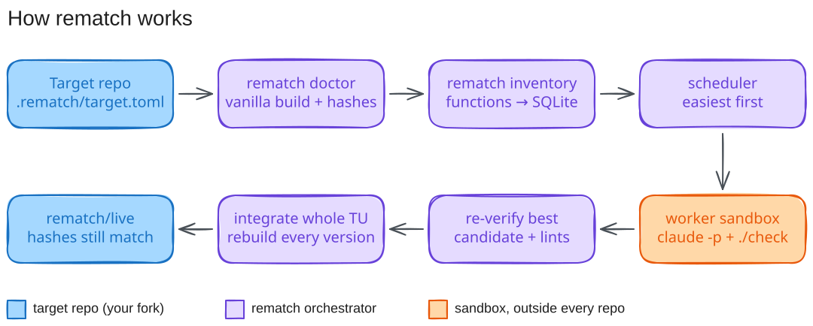
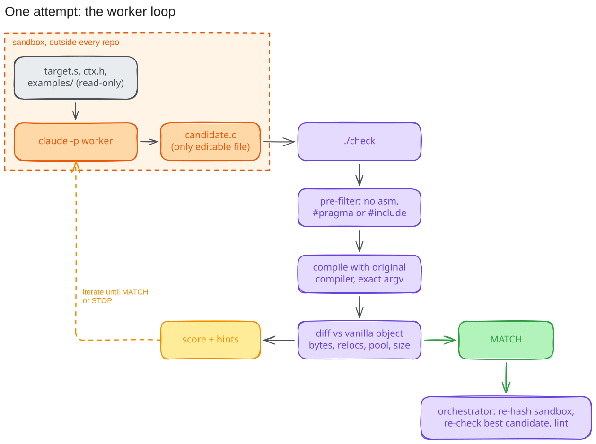

# rematch

An agent harness that turns compiled assembly back into **byte-matching C**, using headless Claude Code workers.

rematch works on matching-decompilation projects: repos whose build reproduces the original binary byte for byte, with some functions already in C and the rest still in assembly. Each project is a **target**, and it describes itself in a `.rematch/` directory inside its own repo (SPEC §2). This repo contains no target-specific code or data.

> Status: pre-alpha. Start at ROADMAP.md, Phase 0.

---

## What it does



Every unmatched function becomes a small, sandboxed task. A worker (`claude -p`) gets the target assembly, the header context, a few similar already-matched functions, and one tool: `./check`. That tool compiles the candidate C with the target's original compiler (same flags as the real build) and diffs the result instruction by instruction against the original. The worker iterates until the diff is empty.



The orchestrator schedules work, records every attempt in SQLite, and verifies matches independently. Once every function in an assembly translation unit (TU) matches, it integrates that TU into the target repo, rebuilds every version, and checks the hashes.

There are two modes:

| Mode | Targets | Purpose |
|---|---|---|
| `bench` | Functions humans already decompiled. Their C is hidden and the compiled original is the answer key. | Measures the harness: match rate, attempts, cost per match. |
| `live` | Functions still in assembly | Makes real progress on the target. |

## Ground rules (non-negotiable)

- **No ROMs, BIOS files, or dumps are ever committed**, to this repo or a target repo. Targets build from source.
- Only work on games you own.

## Requirements

- Python 3.12+ and [uv](https://docs.astral.sh/uv/)
- Claude Code **≥ 2.1.259** (for `--permission-prompts`)
- The target's build dependencies, either on the host or in a container reached through `TOOLCHAIN_EXEC` (SPEC §4)
- An `objdump` for the target's architecture
- `objdiff-cli` (preferred diff backend, verified in Phase 1). Fallback backend: objdump plus our own normalizer.

## Quickstart

```bash
# Target repo: your own fork or clone, with a .rematch/ directory (SPEC §2)
cd /path/to/rematch
uv sync
cp .env.example .env            # TARGET_REPO, TARGET_PIN, optional TOOLCHAIN_EXEC
uv run rematch doctor           # Claude Code version, workdir, vanilla builds, hashes
uv run rematch inventory        # parse the target, populate the DB
uv run rematch selftest         # oracle agent end to end; spends NO tokens
uv run rematch bench --n 25     # first real benchmark; spends tokens
uv run rematch report --last
```

Commands after `doctor` arrive phase by phase (ROADMAP.md).

## Docs

| File | What's in it |
|---|---|
| `DESIGN.md` | Why the system is shaped this way, prior art, decisions, risks |
| `SPEC.md` | **Authoritative.** Target definition, layout, config, schema, CLI, tool contract, worker invocation, procedures |
| `ROADMAP.md` | Phases with exit criteria |
| `AGENTS.md` | Rules and traps for coding agents working on this repo |
| `CLAUDE.md` | Claude Code–specific notes (imports AGENTS.md) |
| `CONTRIBUTING.md` | Workflow, prompt versioning, benchmark hygiene |
| `docs/diagrams/` | README diagrams. Edit the `.excalidraw` source, then re-export the `.svg` |
